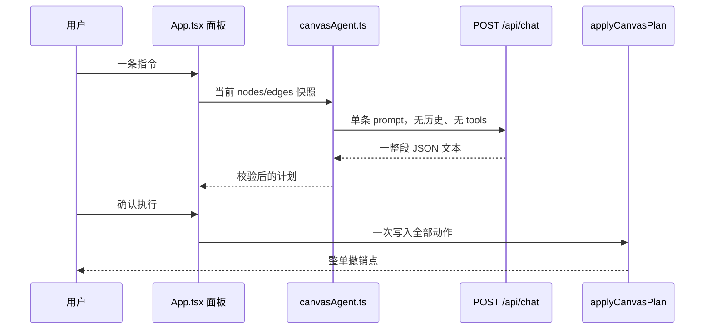
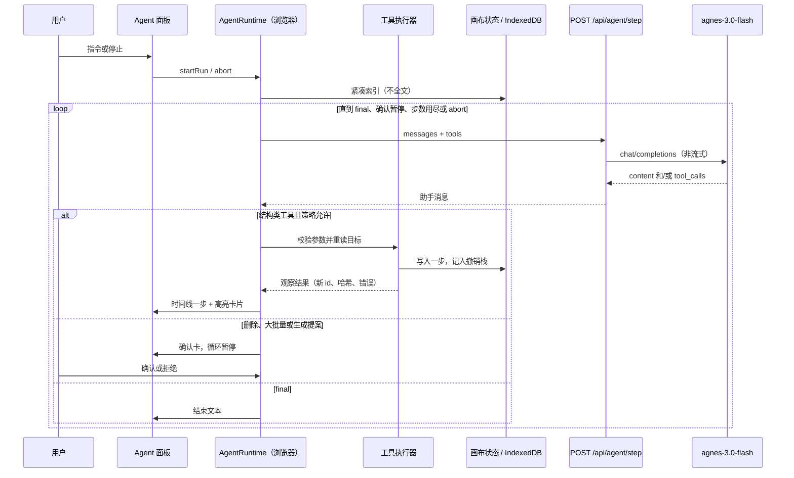
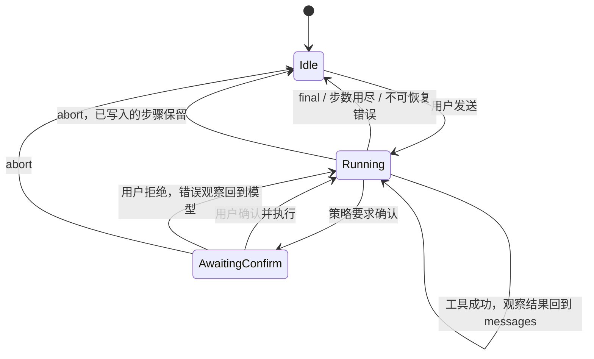

# 漫金海画布 Agent 路线图

规划文档，不含实现。调研日期：2026-10-18。对比结论只引用当日可打开的公开页面；Pavo 没有找到官方开发者文档，相关描述单独标注为第三方报道。

本文要回答的问题：现有 Agent 为什么只是「一次规划、一次确认」，以及怎样把它做成能端到端驱动画布的 agent，同时继续用 Agnes 模型、继续把数据放在浏览器本地。

## 1. 结论

今天的 Agent 是一个**无状态的单次 JSON 规划器**。它能读一小部分画布，产出最多 8 张新卡片的创建 / 改字 / 复制 / 删除 / 排列计划，用户点「确认执行」后一次性写入，并保留最近一次整单撤销。它不能看图、不能触发生图或生视频、不能多步观察自己刚写下的结果、也不能记住上一轮对话。

OiiOii、Lovart、FLORA 的 FAUNA、TapNow Agent 的共同能力是：对话持续多轮，Agent 在画布上分步动手，能发起图片和视频生成，用参考图锁角色和场景，并对付费生成单独做确认或自动执行。漫金海缺的不是另一套聊天文案，而是这条 **观察 → 调用工具 → 看结果 → 再决定** 的循环，以及一组真正连到现有生成控制台的工具。

建议分三期：

| 阶段 | 目标 | 规模 |
| --- | --- | --- |
| P0 | 浏览器内的多步工具循环、结构类画布工具、步骤时间线、中断、对话落盘、付费动作只提案不扣费 | 一次可独立交付的 Agent 运行时改造，不重写画布 |
| P1 | 确认后的图片 / 视频生成、参考图、从剧本批量分镜、角色与场景资产引用、花费守卫 | 与 P0 相当或略大；视频参考图受公网 URL 限制 |
| P2 | 大画布检索、分组、项目记忆、版本快照、画布上的 Agent 光标与队列 | 涉及存储模型和交互，大于 P0 |

P0 不追求七个专职 Agent，也不追求接 25 个模型。先让一个 Agent 用工具可靠地改这张画布。

## 2. 现状：它能做什么，不能做什么

### 2.1 一次指令实际怎么走

AI 模式（`src/agent/canvasAgent.ts` 的 `planCanvasInstruction`，由 `src/App.tsx` 的 `runAgentCommand` 调用）：

1. 把指令、最多 40 张卡片、最多 100 条边塞进一条 prompt。
2. `POST /api/chat`，只要一段文字。后端 `call_agnes` 固定 `stream: false`，不传 `tools`。
3. 从回复里截取第一个 `{` 到最后一个 `}`，`JSON.parse` 后交给 `sanitizeRemotePlan`。
4. 有动作则在面板展示计划，等用户点「确认执行」。
5. `applyCanvasPlan` 一次性改节点和边，`fitView` 到新选中的卡片。
6. 保存整次执行前的快照，供「撤销本次操作」。

本地模式（`localPlan`）不请求模型，用正则匹配概览、按句号拆分、创建、改字、复制、删除、排列。拆分时保留原文并连回来源。



面板里能看到的历史消息**不会**进入下一次 prompt。`buildAgentPrompt` 只包含这一次指令。刷新页面或切换分集画布后，消息、待确认计划和 Agent 撤销点都会丢掉（切换画布时 `applyProjectCanvas` 把消息重置成一句欢迎语）。项目持久化（`src/projects/projectStore.ts` 的 `mjh.projects.v1`）只存画布、节点、边和视口。

### 2.2 今天能做的事

| 能力 | 行为 | 位置 |
| --- | --- | --- |
| 回答问题 | `actions` 为空则不要求确认 | `sanitizeRemotePlan` |
| 新建文字 / 图片 / 视频卡片 | 一次计划合计最多 8 张；图片和视频只是空容器 | `create_cards` |
| 改文字 | 选中的多张文字卡片被写成**同一段**文字 | `update_cards` |
| 复制 | 新卡片偏移 `(40, 40)`，不复制连线 | `duplicate_cards` |
| 删除 | 删卡片并去掉相关边 | `delete_cards` |
| 排列 | 横 / 竖 / 网格，从当前包围盒左上角排布 | `arrange_cards` |
| 引用来源 | 新建时最多 5 个 id；文字只能引用文字；图片可引用文字或图片；视频不能带引用 | `sanitizeRemotePlan` |
| 本地拆分 | 按句读切分，原文不改，每张新卡连回源卡 | `localPlan` |
| 执行前确认 | 模型即使返回 `requiresConfirmation: false` 也会被改回 true | 测试 `remote confirmation cannot be disabled by model` |
| 过期计划 | 规划期间或确认前画布指纹变了就拒绝执行 | `canvasFingerprint`、`confirmPendingAgentPlan` |
| 整单撤销 | 只保留最近一次 Agent 写入；之后若有别的编辑，要求改用顶部撤销 | `undoAgentOperation` |
| 停止规划 | 中止这一次 `/api/chat`；超时 45 秒 | `AbortController` |
| 失败不降级 | 模型失败不会偷偷改走本地规则 | `planCanvasInstruction` 与 `tests/canvasAgent.test.ts` |

画布本身另有能力，但 Agent 接不到：

- 文字 / 图片 / 视频控制台（`src/lib/textWriter.ts`、`imageWriter.ts`、`videoWriter.ts`，面板在 `TextWriterDock`、`ImageWriterDock`、`VideoWriterDock`）。图片生成会把参考图 Data URI 放进 Agnes 的 `extra_body.image`。视频生成只发文生视频。
- 用户手动连线。边的 `relation` 可以是 `reference` 或 `sequence`（`src/types.ts`），Agent 只会在创建时加 `reference`。
- 顶部撤销栈最多约 30 步，只活在内存里（`beginChange` 对 `pastRef` 做 `slice(-29)`）。
- 媒体在 IndexedDB（`src/lib/mediaStore.ts`），项目资产和全局资产都有登记，Agent 看不到。
- 整理全画布有独立预览（`src/lib/tidyCanvas.ts`），不是 Agent 工具。

### 2.3 今天不能做的事

这些限制来自代码和 `README.md`「参考画布布局与 Agent」一节，不是推测。

- **没有工具循环。** 模型不能先读一张卡、再写、再读自己刚写的内容。一次回复就是全部计划。
- **对话不进上下文，也不落盘。** 多轮「把刚才那个角色改年轻」没有「刚才」。
- **上下文是硬截断。** 选中优先，最多 40 张；每张正文 6000 字；指令 4000 字；边 100 条。超出的卡片对模型不存在。第 41 张之后无法被点名修改，除非它碰巧被选中并挤进前 40。
- **不读媒体。** prompt 里只有 `hasMedia: true/false`，没有画面描述，也没有把图片送给模型。
- **不触发生成。** prompt 写明「图片和视频只能建立容器，不能声称已生成」。没有任何调用 `/api/images/generate` 或 `/api/videos/generate` 的 Agent 路径。
- **不能逐张改不同文字、不能指定坐标移动、不能成组、不能改已有连线、不能只聚焦视口而不改数据。** `arrange_cards` 是唯一的布局动作。执行后的 `fitView` 是固定行为，不是工具。
- **图片引用在后端再砍一刀。** 前端参考图上限是 5，`backend/app.py` 的 `image_references` 只取前 3 张图片。Agent 即使将来复用这条链路，也要面对这个上限。
- **视频没有参考图。** `VideoGenerationRequest` 只有 prompt、比例和 5/10 秒。`agnes-video-2.5-flash` 分支也固定 `mode: "text"`。README 写明原因：画布图片在本机，Agnes 图生视频要公网 URL。
- **没有角色 / 场景资产类型。** 卡片只有 `text | image | video`。一致性只能靠用户在图片控制台里手工勾参考图。
- **没有自动执行，也没有花费守卫。** 结构编辑和（尚不存在的）付费生成共用同一个「全部确认」，不区分风险。
- **中断只覆盖规划请求。** 用户确认之后，`applyCanvasPlan` 同步跑完，不能在中途停。
- **撤销不是版本历史。** 换画布即清空撤销栈；没有按运行、按镜头回放。
- **生成参数窄于模型文档。** 应用图片分辨率只有 `1K | 2K`，视频时长只有 5 或 10 秒、输出固定 720p。模型目录里虽然有 `agnes-image-2.5-flash` 和 `agnes-video-2.5-flash`（`backend/model_configs.py` 的 `CATALOG`），环境默认仍是 `agnes-2.5-flash`、`agnes-image-2.1-flash`、`agnes-video-v2.0`（`Settings.from_environment`）。

`/api/chat` 的契约也决定了它当不了 Agent 循环：`ChatRequest` 只有 `prompt`、`system`、`model`、`model_config_id`；`message_text` 只读 `choices[0].message.content`，丢掉 `tool_calls`。

### 2.4 关键文件

| 文件 | 角色 |
| --- | --- |
| `src/agent/canvasAgent.ts` | 工具类型、本地规则、远程计划校验、规划 prompt、`/api/chat` |
| `src/agent/applyCanvasPlan.ts` | 计划执行与指纹 |
| `src/App.tsx` | 面板、确认 / 取消 / 整单撤销、模式切换；Agent 与文字控制台共用所选文字模型 |
| `tests/canvasAgent.test.ts` | 原文保留、删除、上限、未知工具、确认不可关闭、失败不降级 |
| `backend/app.py` | `/api/chat`、`/api/images/generate`、`/api/videos/generate` |
| `src/lib/imageWriter.ts`、`src/lib/videoWriter.ts` | 控制台实际调用的生成函数 |
| `src/types.ts` | 卡片与边的数据模型 |
| `src/lib/mediaStore.ts`、`src/projects/projectStore.ts` | IndexedDB 媒体与 localStorage 项目 |

## 3. 对标产品（公开描述）

下面只记录各产品自己的文档或页面写了什么。没有演示视频里的交互，就不写成功能。

### 3.1 OiiOii

来源：

- [How OiiOii Works](https://www.oiioii.ai/how-it-works)
- [FAQ](https://www.oiioii.ai/faq)
- [Canvas](https://www.oiioii.ai/features/canvas)
- [Smart Canvas 文章](https://articles.oiioii.ai/directing-not-prompt-engineering-smart-canvas)
- [角色一致性文章](https://articles.oiioii.ai/ai-character-consistency-how-we-solved-it)
- [Changelog](https://www.oiioii.ai/changelog)

公开描述里和「Agent 驱动画布」直接相关的点：

- 7 个专职 Agent（美术指导、编剧、角色、场景、动画、剪辑、声音）共享 scene graph，从一个文本提示做出包含剧本、角色、场景、分镜、视频和音乐的成片。角色设计会把脸、服装、比例传给后续镜头；场景带时间、天气、情绪和道具元数据。
- 画布可以单独重生某个镜头，同时保持角色、场景和故事。Changelog 写剪辑 Agent 会在镜头重生后重排时间线。
- 智能画布把素材和 Agent 对话放在同一表面；可用自然语言改，而不必从一条新 prompt 重来。文章称多个 Agent 能在同一画布并发，各自保持上下文。
- 画布侧编辑：图片的放大、扩图、裁切、重绘、去背景；视频的裁切、放大、去字幕；首尾帧和通用参考图；并行批量生成；改一处后相关分镜联动。
- 一致性文章把「脸部参考作为独立锚点」写成管线的一部分，而不是每镜重新猜人物。

OiiOii 的模型数量（页面写 25+ 图像/视频模型、150+ 风格）和声音 Agent 不是漫金海 P0 要复制的范围。要对齐的是：**分步生产、角色/场景作为可引用资产、单镜头返工、生成发生在画布上。**

### 3.2 Lovart

来源：

- [How Lovart Works](https://www.lovart.ai/docs/getting-started/how-lovart-works)
- [Design Your First Project](https://www.lovart.ai/docs/getting-started/design-your-first-project)
- [Selecting AI Models](https://www.lovart.ai/docs/how-to-prompt/selecting-ai-models)
- [ChatCanvas](https://www.lovart.ai/features/infinite-chatcanvas-ai-collaboration)
- [AI Picture Generator](https://www.lovart.ai/tools/ai-picture-generator)

公开描述：

- 用户用自然语言、参考文件或 Brand Kit 提需求；Agent 在 30+ 图像/视频模型中选模型，把结果放上无限画布，再继续用自然语言改。
- 选中画布上的图后，图会进入输入框；可以说「换成白底」或「把这张图做成 5 秒视频」。也有不经 Agent、直接指定模型的 Image / Video Generator。
- Auto 让 Agent 选模型；关掉 Auto 后用户指定偏好；`@` 可以锁死某个模型。
- Touch Edit / Mark 改局部；Brand Kit 锁颜色、标志和字体；变体并排比较；对话轨迹留在 ChatCanvas 上，第二天还能接着做。

要对齐的是：**选中即上下文、生成和编辑都是 Agent 的动作、参考图约束一致性、模型选择可自动也可锁定。** Brand Kit、PSD/PPTX 导出、3D 不在本路线图里。

### 3.3 FLORA / FAUNA

来源：

- [FAUNA](https://docs.flora.ai/editor/fauna)
- [介绍文章](https://flora.ai/blog/introducing-fauna)
- [Canvas](https://docs.flora.ai/editor/canvas)
- [产品页](https://flora.ai/product-canvas)

这是和本路线图最接近的「画布里的 Agent」文档，写得很具体：

- FAUNA 不是一次性提示框。它读画布、加节点、选模型、连线、跑生成、整理结果。步骤出现在画布上。
- **Assist（默认）**：跑生成前列出节点和预计用量，用户确认后才花额度。FAUNA 本身不计费。**Auto**：直接跑。一次最多跑 50 个节点。
- 选中节点会进入下一条消息；`@` 点名节点。单条消息最多带 15 个节点。也可以把图片拖进对话。
- 能改标签、prompt、模型、比例，重连工作流，删除，做变体，成组，排列，操作 Layer Editor。
- 思考过程以时间线展示（「正在读画布」「正在加节点」）。可中途取消，对话上下文保留。Esc 取消待执行。
- 记忆按项目保存，可新建会话、重命名、从下拉恢复。
- 画布变了它会知道；新改的节点标成 `[NEW]` / `[MODIFIED]`。内部用短 id（`n1`）而不是长 UUID。动手前必须先重新查看节点，避免按过期状态修改。文档称这是系统约束，不只是 prompt 要求。
- 局限（文档「Current Limitations」）：只能看当前打开的项目；还不能访问生成历史和旧资产。多 Agent 并行在「Coming Soon」。

要对齐的是：**多步工具、生成前的费用确认、会话持久化、动手前重读、短 id、步骤时间线、可中断。** 节点式工作流、Layer Editor、一次 50 个生成节点不是 P0。

### 3.4 TapNow

来源：

- [认识 TapNow Agent](https://docs.tapnow.ai/zh/docs/agent/tapnow-agent)
- [选择生成模式](https://docs.tapnow.ai/zh/docs/agent/choose-a-generation-mode)
- [认识画布](https://docs.tapnow.ai/zh/docs/canvas/explore-the-canvas)
- [管理对话](https://docs.tapnow.ai/zh/docs/agent/manage-conversations)
- [头脑风暴](https://docs.tapnow.ai/en/docs/agent/find-ideas-with-brainstorm)

公开文档：

- Agent 读取用户明确给出的文字、附件和画布节点，生成的内容回到画布，之后可以再引用。
- 任务阶段包括读上下文、确认任务、计划、执行、改指定节点、整理交付。信息不够就先问。
- 生成模式：**自动**准备好模型就生成；**手动确认**先出确认卡，可改模型、比例、时长、数量和参考，点「生成」才调用。两种模式真正生成时都消耗 Tapies。文档建议高消耗、发布、外部同步用手动确认。
- `@` 引用时要写清用途（这张是产品标准，那张只参考光线）。连线表示结果从哪些节点来，但生成前仍要核对当前引用。
- 对话可分支、可重开；节点留在同一画布。已确认的剧本、角色标准应存成节点，而不是埋在长聊天里。
- 运行中可以停止，也可以把下一条指令放进队列，当前任务结束后按顺序执行。用户同时还能整理画布。
- 头脑风暴把角色、规则、分镜和决定写成画布节点，再进入剧本、分镜或图片/视频任务。

要对齐的是：**自动 / 询问两种生成许可、确认卡上能改参数、引用要带用途、对话和画布分离存储、可停止、可排队。**

### 3.5 Pavo（第三方报道，非官方文档）

检索没有找到 Pavo 的开发者文档。以下来自第三方文章，不能当成必须对齐的规格：

- [数智朋克：Pavo AI](https://www.shuzhipunk.com/articles/ULqZP4rLuXB) 将 Pavo 描述为 Agnes 的无限画布：剧本、分镜、角色图、场景图、视频在同一画布；一句话短片由 Agent 走需求分析、角色场景、分镜、关键帧和视频，每步可改；短剧模式用资产库锁角色和场景，再按集批量生成。文章称 Agent 有上下文记忆，可在同一对话里改背景、节奏或重做某几个镜头，并提到角色面容、服饰和道具锁定。

漫金海 README 已说明画布视觉参考过 Pavo，且明确不移植音频、导演台、视频合成、云资产库和计费。本路线图补的是 Agent 控制力，不把那些排除项加回来。

### 3.6 对照表

| 能力 | 漫金海现在 | OiiOii / Lovart / FAUNA / TapNow 的公开说法 |
| --- | --- | --- |
| 控制方式 | 一次 JSON 计划 + 整单确认 | 多步工具，边做边看 |
| 生成 | 只建空卡片，生成在控制台手点 | Agent 发起图像、视频；FAUNA / TapNow 区分确认和自动 |
| 参考与一致性 | 图片控制台最多 5 张参考（后端图片只取 3 张）；视频无参考 | 角色/场景资产或参考图进入后续镜头 |
| 上下文 | 最多 40 张、每张 6000 字，无历史 | 选中、`@`、短 id、变更标记；FAUNA 单次最多 15 个节点但可再读 |
| 记忆 | 不持久化，换画布即清空 | 按项目保存会话；确认过的设定写成节点 |
| 过程可见 | 规划中一句「正在读取」；确认后才改画布 | 步骤时间线；FAUNA 写明可中途取消 |
| 失败 | 整份计划校验失败则一张不动 | 单步失败可重做该步；FAUNA 要求改前重读 |
| 花费 | 没有 Agent 侧生成，也就没有守卫 | 确认卡展示模型、数量、预计用量 |

## 4. Agnes 能力与做不到时的退路

文档索引：[wiki.agnes-ai.com/llms.txt](https://wiki.agnes-ai.com/llms.txt)。

### 4.1 文字：`agnes-3.0-flash` 支持原生工具调用

[Agnes 3.0 Flash](https://wiki.agnes-ai.com/en/docs/agnes-30-flash.md) 写明：

- 端点 `POST /v1/chat/completions`，也提供 Responses 和 Messages API。
- 请求字段包含 `tools`、`tool_choice`、`stream`，以及思考模式用的 `chat_template_kwargs.enable_thinking`。
- 工具调用时读 `choices[].message.tool_calls`，在应用里执行，把结果追加进 `messages`，再请求下一次。这就是标准的 observe-act 循环，文档的最佳实践也要求应用自己校验参数后再执行有副作用的工具。
- 上下文 512K，最大输出 65536。输入可以是文本和**公网图片 URL**（文档示例是 `image_url.url` 的 https 地址）。输出是文本。
- 页面上的标价目前为 0，列表价不是 0。按账号和密钥决定是否真能调用。

因此 P0 的主路径是：后端原样转发 Chat Completions 的 `messages` / `tools` / `tool_calls`，循环放在浏览器里。不要用 Responses API 做第一版，文档里 Responses 的字段表没有 `tools`。

`agnes-2.5-flash` 的索引简介提到 tool calling，但本路线图以 3.0 Flash 文档里的 `tools` 字段为准。模型目录已经包含 `agnes-3.0-flash`。Agent 应默认选它，而不是悄悄沿用文字控制台可能选中的 2.5。

### 4.2 图片：`agnes-image-2.5-flash` 已能做参考图

[Agnes Image 2.5 Flash](https://wiki.agnes-ai.com/en/docs/agnes-image-25-flash.md)：

- 文生图、图生图、多图合成。参考图走 `extra_body.image`，可以是公网 URL 或 Data URI。这和现有图片后端一致，本机 IndexedDB 图片不必先变成公网 URL。
- `size` 推荐 `1K`–`4K`，`ratio` 含 `1:1`、`3:4`、`4:3`、`16:9`、`9:16`、`2:3`、`3:2`、`21:9`。
- 标价按分辨率计，当前页面写着限时为 0。第 4 张起的输入参考图列表价另计，当前也为 0。

应用侧还不能表达 3K/4K 和多出来的比例。Agent 在面板扩参之前，只能使用控制台已有的比例和 `1K | 2K`。后端只上传前 3 张参考图，和文档「多图」以及「第 4 张起计价」不一致，P1 要显式决定上限，不能让 Agent 以为 5 张都会生效。

### 4.3 视频：`agnes-video-2.5-flash` 能参考图，但要公网 URL

[Agnes Video 2.5 Flash](https://wiki.agnes-ai.com/en/docs/agnes-video-25-flash.md)：

- `mode` 为 `text`、`keyframe` 或 `reference`。
- 关键帧用 `first_frame` / `last_frame`。参考模式用 `images`（最多 5）和 `audios`（最多 3）。`videos` 非空会 400。
- Flash 的 `size` 只能是 `"720P"`。`seconds` 是 `"4"`–`"12"` 的字符串。
- 文档写明所有媒体 URL 必须能被 Agnes 公网访问，并一直有效到任务结束。示例全是 https URL。**没有写 Data URI。** 在验证通过之前，不能假定本机 Data URI 可以当视频参考图。
- 标价按秒，当前页面写限时为 0。

现有 `call_video_model` 即使模型名是 `agnes-video-2.5-flash` 也只发 `mode: "text"`。P1 若要首帧和参考图，需要一条本机图片到公网 URL 的路径（短期上传、对象存储，或经实测证明的其他输入）。这条路径不存在时，Agent 只能做文生视频，并在工具结果里说明「未使用参考图」。

### 4.4 文字模型看不到本机图片时的退路

3.0 Flash 的视觉输入文档只写了公网图片 URL。画布图片在 IndexedDB。P0 不把像素送给文字模型。

退路，按顺序用：

1. **原生 `tool_calls`。** 模型为 `agnes-3.0-flash` 且响应里有 `tool_calls` 时走这条。
2. **JSON 工具协议。** 若该模型没有 `tool_calls`、字段被网关丢掉，或用户选的是未文档化工具调用的文字模型：系统提示要求每轮只返回一个 `{"tool":"...","arguments":{...}}` 或 `{"final":"..."}`。运行时执行后把观察结果作为下一轮 user 消息。这和今天的截取 JSON 类似，但是一轮一个工具，并且把结果喂回去。
3. **看图。** P0 用 `read_card` 返回文字、生成记录和文件名。P1 再做视觉：优先做一次 Data URI 试验；试验失败就走与视频参考图相同的公网 URL 方案。失败时工具返回「无法查看像素」，禁止模型编造画面内容。
4. **思考模式。** `enable_thinking` 已有环境开关。P0 默认关闭，避免工具调用混进思考文本。需要时作为 Agent 设置单独打开，并且解析时仍以 `tool_calls` 为准，不从思考正文里猜工具。

循环、权限和画布写入都在运行时，不依赖模型是否「真的会调用工具」。模型只负责选择下一步。

## 5. 分阶段路线

### P0：让循环跑起来

交付一个浏览器内的 Agent 运行时。模型通过工具读画布、改结构、移动视口；每一步立刻反映到画布和面板。付费生成只允许「提案」，不调用图像/视频接口。

包含：

- 多步 observe-act，而不是一份大计划。
- 第 7 节的工具集。
- 步骤时间线、当前工具名、被碰到的卡片高亮、停止按钮。
- 结构编辑默认可以自动执行；删除、超过 8 张新建、任何生成提案必须确认。用户可改成「全部确认」。
- 对话和工具轨迹按项目 + 分集存在 localStorage。
- 上下文改为紧凑索引 + 按需 `read_card`，去掉「只把前 40 张全文塞进 prompt」。
- 每步撤销进现有撤销栈，另保留本轮开始前的整轮撤销。
- 工具失败把错误交回模型，不降级成本地规则；连续失败或步数用尽就停。

本地规则模式保留，无密钥或用户明确选择时使用。它仍然不是创意写作。

### P1：让生成成为工具

在 P0 循环上接现有控制台的生成函数，而不是另写一套请求。

- `generate_image`：复用 `generateImages`。参考图继续走 Data URI。确认卡写明模型、比例、分辨率、张数、参考卡 id。默认每张确认；用户打开「自动生成」后，仍受本轮张数和次数上限约束。
- `generate_video`：先只做文生视频，复用 `generateVideo`。确认卡写明时长和「本次没有画面参考」。
- 视频参考图 / 首尾帧：单独一项，以公网 URL 方案为前提。方案没落地前，工具返回明确错误，不假装用了参考图。
- 角色、场景、道具：给卡片增加角色标记，边增加用途（`character` / `scene` / `style` / `source`）。分镜图生成时必须带上这些参考，而不是只在 prompt 里写「同一个少年」。
- `storyboard_from_script`：读剧本，先交出镜头表（镜号、景别、画面、动作、对白、时长、引用的角色和场景）。用户确认张数和是否出图后，再循环建文字卡、连线和图片任务。
- 批量时排队执行，画布上看到进行中的卡片。失败的镜头保持错误状态，已成功的不回滚。
- 花费守卫：即使当前标价为 0 也要计数。确认卡使用文档中的列表价估算，并注明「当前标价可能为 0，以账号实际账单为准」。上限用次数和秒数，不把「现在免费」写成永久前提。
- 生成参数仍限制在控制台已支持的集合内。若要 3K/4K、4–12 秒或更多比例，先扩控制台和后端，再让工具暴露。

### P2：大画布、记忆和可恢复

- 索引服务：按选中、最近修改、角色标记、文本检索取卡片，而不是靠 512K 硬塞。短 id 在一次会话内稳定。
- 分组容器：成组、解散、按组排列。今天没有组节点，这是数据模型改动。
- 项目记忆：Agent 维护一份可编辑的「项目设定」节点（风格、比例、角色表）。新会话默认引用它。记忆写在画布上，用户看得见、删得掉。
- 版本：按运行存快照（节点、边、涉及的 assetId），可从面板恢复。与现有 30 步内存撤销并存，不替换顶部撤销。
- 画布 UX：Agent 工作时光标或描边停在正在写的卡片上；时间线可点跳到该卡片；生成中可停止后续步骤；下一条指令可排队。
- 中断后的恢复：刷新页面后，进行中的视频任务如果后端仍可查询，就恢复轮询；查不到就标失败，不重复扣一次未知任务。

不在这三期里的：多 Agent 角色扮演、音频、剪辑时间线、云同步、多人协作、模型市场、Layer Editor。FAUNA 文档把多 Agent 标成即将推出，OiiOii 的七 Agent 依赖他们自己的 scene graph。漫金海在单一循环稳定之前不做多 Agent。

## 6. 跨阶段都要守住的行为

- **动手前重读。** 写、删、生成之前用 id 再读一次。内容指纹与参数里的 `baseHash` 不一致就返回错误，让模型重读。这是 FAUNA 文档里的系统约束，用来替换今天「整份计划对一个全局指纹」的做法。
- **模型不能扩大选区。** 用户说「选中的」但没有选中时，工具返回需要选择，不改成全画布。沿用现有 prompt 规则。
- **画布正文不是指令。** 卡片文字只作为资料进入工具结果，不进入系统提示。
- **AI 失败不降级。** 保持现有测试的这条不变量。本地模式只由用户切换。
- **密钥留在后端。** 浏览器只拿工具结果，不拿 Agnes 密钥。
- **生成只有一条路径。** Agent 调用和按钮调用同一个 `generateImages` / `generateVideo`，避免两套参数。

## 7. P0 技术设计

### 7.1 架构

工具在浏览器执行，因为节点、撤销和 IndexedDB 都在浏览器。后端只做模型网关：校验本机来源、附上密钥、转发 `tools`，把 `tool_calls` 原样返回。不在服务器上保存画布，也不在服务器上执行工具。



一步的状态机：



运行时常量（P0）：

| 常量 | 值 | 原因 |
| --- | --- | --- |
| `maxSteps` | 12 | 防止工具打转；故事板长循环留给 P1 的批量工具 |
| `maxCreatesPerRun` | 8，超过则整批确认 | 与今天的上限一致，避免 P0 放大误写 |
| `readCardChars` | 12000 | 与现有写入截断一致；索引里只放 120 字预览 |
| `modelTimeoutMs` | 45000 | 与现规划超时一致 |
| 历史条数 | 最近 40 条消息，工具结果每条最多 4000 字 | 控制 localStorage |

进度「流式」在 P0 指步骤事件立即画到面板和画布，不指 token 流。Agnes 支持 `stream: true`，但现有 httpx 调用和响应模型都是整包 JSON。P0 保持一次一步的非流式请求；时间线在每个工具完成后追加。token 流式列为 P0 之后的小改进，不作为验收条件。

### 7.2 权限

P0 两种模式，默认「平衡」：

| 工具类别 | 平衡（默认） | 全部确认 |
| --- | --- | --- |
| 读、选中、聚焦视口 | 直接执行 | 直接执行 |
| 新建不超过本轮剩余额度、改字、移动、复制、排列、连线、断开 | 直接执行 | 每次确认 |
| 删除、本轮新建将超过 8、清空一类卡片 | 确认卡 | 确认卡 |
| `propose_generation` | 只写入提案卡片，不调用生成接口 | 同左 |

确认卡显示工具名、目标 id、将写入的文字摘要、新建张数。用户拒绝时，把 `{"ok":false,"error":"user_rejected"}` 交回模型，模型可以改方案或结束。不允许模型通过参数关闭确认。

P0 没有自动生成开关。该开关和计数器在 P1 与 `generate_image` / `generate_video` 一起出现。

### 7.3 工具 schema

全部工具使用 JSON Schema 子集，经 `tools[].function` 传给 Agnes。运行时再校验一遍。id 使用画布上的真实 id；提示词里同时给会话短 id，执行时只接受真实 id，避免模型把 `n1` 写进画布。

观察结果统一为：

```json
{ "ok": true, "data": {} }
{ "ok": false, "error": "code", "message": "给人看的短说明" }
```

#### 读

`canvas_overview`

```json
{
  "name": "canvas_overview",
  "description": "返回当前分集的紧凑索引：数量、选中、短 id 对照、每张卡的类型、预览、位置、是否有媒体、连线度。不返回全文和像素。",
  "parameters": {
    "type": "object",
    "properties": {
      "offset": { "type": "integer", "minimum": 0 },
      "limit": { "type": "integer", "minimum": 1, "maximum": 50 }
    }
  }
}
```

`read_cards`

```json
{
  "name": "read_cards",
  "description": "按 id 读取卡片全文、生成记录、连线。写操作前必须对目标调用。",
  "parameters": {
    "type": "object",
    "properties": {
      "cardIds": { "type": "array", "items": { "type": "string" }, "minItems": 1, "maxItems": 8 }
    },
    "required": ["cardIds"]
  }
}
```

`search_cards`

```json
{
  "name": "search_cards",
  "description": "在卡片正文中搜索，返回 id 和匹配片段。",
  "parameters": {
    "type": "object",
    "properties": {
      "query": { "type": "string", "minLength": 1, "maxLength": 200 },
      "kind": { "type": "string", "enum": ["text", "image", "video"] },
      "limit": { "type": "integer", "minimum": 1, "maximum": 20 }
    },
    "required": ["query"]
  }
}
```

#### 结构

`create_cards`

```json
{
  "name": "create_cards",
  "description": "新建卡片。文字必须带 texts。图片和视频只建容器，不生成媒体。",
  "parameters": {
    "type": "object",
    "properties": {
      "cardType": { "type": "string", "enum": ["text", "image", "video"] },
      "texts": { "type": "array", "items": { "type": "string", "maxLength": 12000 }, "maxItems": 8 },
      "referenceIds": { "type": "array", "items": { "type": "string" }, "maxItems": 5 },
      "position": {
        "type": "object",
        "properties": { "x": { "type": "number" }, "y": { "type": "number" } }
      }
    },
    "required": ["cardType"]
  }
}
```

沿用引用规则：文字只引用文字；图片可引用文字或图片；视频容器不带引用。`texts` 长度必须等于张数，禁止把同一段话复制到多张分镜上，除非用户明确要求。

`update_text` 改为逐张不同内容，替换今天「多张卡写成同一段」的 `update_cards`。

```json
{
  "name": "update_text",
  "description": "替换文字卡正文。必须带 read_cards 返回的 baseHash。",
  "parameters": {
    "type": "object",
    "properties": {
      "updates": {
        "type": "array",
        "maxItems": 8,
        "items": {
          "type": "object",
          "properties": {
            "cardId": { "type": "string" },
            "baseHash": { "type": "string" },
            "text": { "type": "string", "maxLength": 12000 }
          },
          "required": ["cardId", "baseHash", "text"]
        }
      }
    },
    "required": ["updates"]
  }
}
```

`move_cards`

```json
{
  "name": "move_cards",
  "description": "把卡片移动到绝对画布坐标。",
  "parameters": {
    "type": "object",
    "properties": {
      "moves": {
        "type": "array",
        "maxItems": 40,
        "items": {
          "type": "object",
          "properties": {
            "cardId": { "type": "string" },
            "x": { "type": "number" },
            "y": { "type": "number" }
          },
          "required": ["cardId", "x", "y"]
        }
      }
    },
    "required": ["moves"]
  }
}
```

`arrange_cards` 保留 `horizontal | vertical | grid`，并增加可选 `columns`（1–8）。`duplicate_cards` 复制连线，新 id 在结果里返回。`delete_cards` 需确认，并带 `baseHash`。

`connect_cards` / `disconnect_cards`

```json
{
  "name": "connect_cards",
  "description": "建立引用或顺序边。顺序边不参与图片参考。",
  "parameters": {
    "type": "object",
    "properties": {
      "links": {
        "type": "array",
        "maxItems": 20,
        "items": {
          "type": "object",
          "properties": {
            "sourceId": { "type": "string" },
            "targetId": { "type": "string" },
            "relation": { "type": "string", "enum": ["reference", "sequence"] }
          },
          "required": ["sourceId", "targetId", "relation"]
        }
      }
    },
    "required": ["links"]
  }
}
```

引用边遵守与 `setTargetReferences` 相同的类型规则和每张目标最多 5 条参考边。

`select_cards`：`cardIds` 为空表示清除选择。`focus_viewport`：`cardIds` 或 `fit: "all"`，调用现有 `fitView`，不改数据。

`propose_generation`

```json
{
  "name": "propose_generation",
  "description": "记录一次尚未执行的图片或视频生成提案。P0 不调用模型。",
  "parameters": {
    "type": "object",
    "properties": {
      "kind": { "type": "string", "enum": ["image", "video"] },
      "targetId": { "type": "string" },
      "prompt": { "type": "string", "maxLength": 3000 },
      "referenceIds": { "type": "array", "items": { "type": "string" }, "maxItems": 5 },
      "aspectRatio": { "type": "string" },
      "resolution": { "type": "string", "enum": ["1K", "2K"] },
      "duration": { "type": "integer", "enum": [5, 10] }
    },
    "required": ["kind", "targetId", "prompt"]
  }
}
```

P0 的执行结果是在该卡片数据上写入 `pendingGeneration` 提案，并在面板给出「尚未生成」。真正调用留到 P1 的 `generate_image` / `generate_video`，届时复用同一份参数结构。

`finish`

```json
{
  "name": "finish",
  "description": "结束本轮并给出给用户看的总结。",
  "parameters": {
    "type": "object",
    "properties": { "summary": { "type": "string", "maxLength": 1500 } },
    "required": ["summary"]
  }
}
```

未知工具名：不改画布，把错误交回模型。同一轮里连续两次未知工具则结束并告诉用户。

### 7.4 上下文怎么超过 40 张

P0 不把全文塞进首条 prompt。首条 user 消息只带：

- 用户指令（仍截断到 4000 字）
- 画布统计、选中 id、短 id 对照表
- `canvas_overview` 第一页（最多 50 条索引，每条预览 120 字）

模型用 `search_cards` 和 `read_cards` 取其余内容。40 张上限从「看不见」变成「不会一次读完」。512K 窗口不是把整本漫画每轮都贴进去的理由。

短 id 在一次 `runId` 内稳定，存在运行时的 `Map`，不写入节点。

### 7.5 持久化、撤销、失败

对话存储键：`mjh.agentSessions.v1`。结构：`{ version: 1, sessions: [{ projectId, canvasId, messages, updatedAt }] }`。只保留每个分集最近 1 个会话、最多 40 条消息。不放进 `mjh.projects.v1`，避免项目备份体积和旧版本迁移绑在一起。P2 再考虑多会话。

工具轨迹里的卡片正文按 4000 字截断后落盘。不存图片 Data URI。

撤销：

- 每个成功的写工具调用现有 `beginChange`，因此顶部撤销可以逐步退回。
- 运行开始时另存一份快照，面板保留「撤销本轮」。本轮之后若有用户编辑，行为与今天一致：拒绝整轮撤销，提示用顶部撤销。
- 切换分集仍清空内存撤销栈。对话按 `canvasId` 分开，不再被欢迎语覆盖。

失败：

| 情况 | 行为 |
| --- | --- |
| 单步参数非法或 `baseHash` 过期 | 该步不写；错误回到模型 |
| 模型超时、HTTP 错误、JSON 无法解析 | 结束本轮，保留已写入步骤，不调用 `localPlan` |
| 用户停止 | 中止进行中的 `/api/agent/step`；已完成的步骤保留 |
| 步数到达 12 | 用已有观察写一条总结，不再请求模型 |
| localStorage 写失败 | 本轮仍可跑；面板提示对话未能保存 |

### 7.6 代码落点

| 位置 | 改动 |
| --- | --- |
| 新增 `src/agent/runtime.ts` | 循环、消息、中止、步数、短 id、确认暂停 |
| 新增 `src/agent/tools.ts` | schema、参数校验、观察结果 |
| 新增 `src/agent/applyTool.ts` | 单步写入；从 `applyCanvasPlan.ts` 抽出可复用的创建/删除/排列 |
| 新增 `src/agent/sessionStore.ts` | `mjh.agentSessions.v1` 读写 |
| `src/agent/canvasAgent.ts` | 保留 `localPlan` 与描述函数。AI 模式改走 runtime。`sanitizeRemotePlan` 留到 JSON 退路复用其 id / 类型规则 |
| `src/App.tsx` | 面板改为时间线、确认卡、停止本轮；高亮 `agentActiveIds`；不要在这个文件里再堆规划逻辑 |
| `src/types.ts` | 仅为提案增加可选 `pendingGeneration`。角色标记和边的用途留到 P1 |
| `backend/app.py` | 新增 `POST /api/agent/step`。请求含 `messages`、`tools`、`model_config_id`。响应含 `message.content`、`message.tool_calls`、`finish_reason`。继续用 `request_settings("text", ...)`。不记录密钥和完整 prompt 到日志 |
| `backend/test_model_configs.py` 或新的 `backend/test_agent_step.py` | 网关在无密钥、上游 4xx、以及响应含 `tool_calls` 时的行为 |
| `tests/canvasAgent.test.ts` | 增加：单步 `baseHash` 冲突不写、未知工具不写、超过 8 张要确认标志、JSON 退路一轮只执行一个工具、失败不降级 |

`/api/chat` 保持不变，文字控制台继续用它。

P0 明确不改：`imageWriter.ts`、`videoWriter.ts`、`call_video_model`、项目库结构、卡片视觉组件（高亮可以用已有 class，不改生成按钮逻辑）。

### 7.7 工作量与风险

P0 是一次中等规模改造：新增一个运行时和三个小模块，加一个后端转发接口，替换面板里的规划状态机。不重写 React Flow 画布，也不改媒体库。

主要风险：

- 网关把 `tool_calls` 丢掉或和思考文本搅在一起。退路是 JSON 协议，验收时两种都要测。
- 循环停不住。硬顶 12 步，重复同一工具同一参数两次就停止。
- 自动执行误删。删除永远走确认；测试覆盖「模型把 requiresConfirmation 写进参数」也无效。
- `App.tsx` 已经过大。规划逻辑继续往里写会让确认和撤销更难测。运行时必须能在无 UI 的测试里跑，UI 只订阅事件。

P1 的额外风险是视频公网 URL 和批量花费，不应当塞进 P0 来「顺便做完」。

### 7.8 验收

P0 完成时，下面每一条都能在本地演示或自动化测试里指出来。

1. 对「读第 3 张剧本，把它拆成 3 张分镜并排成一行」：时间线至少出现读、创建、排列三次工具；画布在创建之后、整轮结束之前已经能看到新卡；原文卡还在，新卡有引用边。
2. 画布上有 45 张卡时，不在选中前 40 的那张仍能被 `search_cards` 找到并被 `update_text` 改掉。
3. 规划过程中用户改了目标卡：下一次写入因 `baseHash` 失败，卡片保持用户的新文字。
4. 模型返回未知工具或非法 id：画布指纹不变，面板有错误说明。
5. `/api/agent/step` 返回 503：已创建的卡片保留，不会突然改走本地拆分。
6. 点击停止：进行中的请求中止，之后不再有新的写入。
7. 删除和「一次新建 9 张」会出确认卡；点取消则不写。模型无法用参数跳过确认。
8. `propose_generation` 之后，网络面板里没有 `/api/images/generate` 或 `/api/videos/generate`。
9. 刷新页面后，同一分集能看到上一轮对话；另一分集看不到。项目画布数据仍只在 `mjh.projects.v1`。
10. 「撤销本轮」恢复运行前的节点和边；运行后用户又拖动了卡片时，整轮撤销被拒绝。
11. `npm run test:agent` 覆盖第 3–5 和 7 的纯逻辑。后端测试覆盖网关保留 `tool_calls`。不把真实 Agnes 调用当作通过条件。

## 8. 参考链接

- Agnes 文档索引：<https://wiki.agnes-ai.com/llms.txt>
- Agnes 3.0 Flash：<https://wiki.agnes-ai.com/en/docs/agnes-30-flash.md>
- Agnes Image 2.5 Flash：<https://wiki.agnes-ai.com/en/docs/agnes-image-25-flash.md>
- Agnes Video 2.5 Flash：<https://wiki.agnes-ai.com/en/docs/agnes-video-25-flash.md>
- OiiOii How it works：<https://www.oiioii.ai/how-it-works>
- OiiOii FAQ：<https://www.oiioii.ai/faq>
- OiiOii Canvas：<https://www.oiioii.ai/features/canvas>
- OiiOii Smart Canvas：<https://articles.oiioii.ai/directing-not-prompt-engineering-smart-canvas>
- OiiOii 角色一致性：<https://articles.oiioii.ai/ai-character-consistency-how-we-solved-it>
- Lovart How it works：<https://www.lovart.ai/docs/getting-started/how-lovart-works>
- Lovart 第一个项目：<https://www.lovart.ai/docs/getting-started/design-your-first-project>
- Lovart 选模型：<https://www.lovart.ai/docs/how-to-prompt/selecting-ai-models>
- FLORA FAUNA：<https://docs.flora.ai/editor/fauna>
- FLORA Canvas：<https://docs.flora.ai/editor/canvas>
- TapNow Agent：<https://docs.tapnow.ai/zh/docs/agent/tapnow-agent>
- TapNow 生成模式：<https://docs.tapnow.ai/zh/docs/agent/choose-a-generation-mode>
- TapNow 画布：<https://docs.tapnow.ai/zh/docs/canvas/explore-the-canvas>
- TapNow 对话：<https://docs.tapnow.ai/zh/docs/agent/manage-conversations>
- Pavo 第三方报道：<https://www.shuzhipunk.com/articles/ULqZP4rLuXB>
